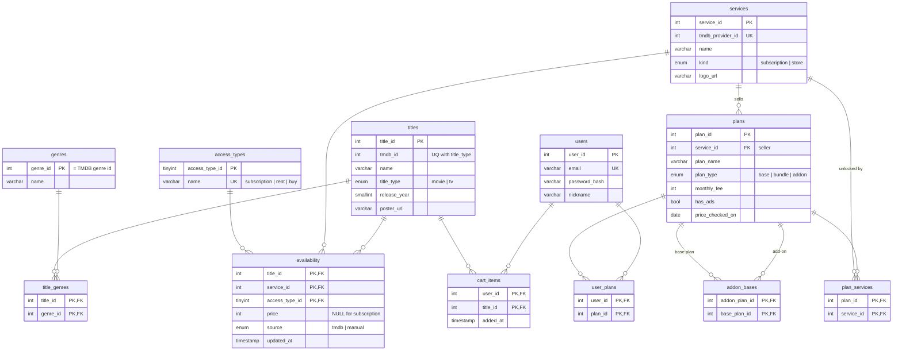

# OTT Cart: Design & Build Plan

A website where users add several movies or dramas to a **cart**, and the site works out the **cheapest way to watch all of them**: which OTT plans to subscribe to and which titles to rent one at a time.

> University project for the SQL database course. Non-commercial.
> Stack: free choice (the course covers both PHP and JSP). The SQL below is MySQL/MariaDB and works with either.
> API research and the table-by-table import plan: **[DATA_SOURCES.md](DATA_SOURCES.md)**.

---

## 1. Concept

### Problem
Many existing sites (JustWatch, Kinolights, etc.) answer *"Where can I watch **this one** title?"*
None answer *"I want to watch **these 5** titles. What's the cheapest combination?"*

### Core idea
- Renting one movie (e.g. ₩3,000) is cheaper than subscribing (e.g. ₩5,000) **if you only want one title**.
- If 2+ titles in the cart are on the same service, the subscription becomes cheaper.
- Multiple services can be combined: *subscribe to TVING + rent one title on wavve*.
- Bundles count too: one **3 PACK** payment unlocks TVING, wavve and Disney+ together.
- Add-ons count too: TVING's **Apple TV 패스** (₩4,400) can only be added to certain TVING plans.

### Example
Cart: Movie A, Movie B, Drama C *(example prices, not real ones)*

| Plan | Cost |
|---|---|
| Rent A + rent B, subscribe to wavve for C | 3,000 + 3,000 + 7,900 = 13,900 |
| Netflix (A, B) + wavve (C) | 13,500 + 7,900 = 21,400 |
| **TVING (A, C) + rent B** | 9,500 + 3,000 = **12,500 ✅** |

### Features
| Priority | Feature |
|---|---|
| Must | Search titles, add them to a cart, view the cheapest plan |
| Must | Explain the result ("renting is cheaper for 1 title; subscribing wins at 2+") |
| Should | "I already subscribe to…", so owned plans cost ₩0 |
| Should | "Ads OK" toggle so cheaper ad-supported plans are allowed |
| Should | Show the top 3 plans, not just the best one |
| Could | Month-by-month rotation (Netflix in Oct → cancel → TVING in Nov) |

### Services in scope
Netflix, TVING, wavve, Coupang Play, Disney+, Watcha, plus **Apple TV+** content, which in practice is reached through TVING (the ₩4,400 **Apple TV 패스** add-on, or TVING Premium). HBO content is on Coupang Play, so it needs no special handling. Details are in [DATA_SOURCES.md §1](DATA_SOURCES.md).

---

## 2. Data sources (summary)

| Data | Source |
|---|---|
| Titles, posters, genres | TMDB API (automatic) |
| Which service has which title in KR | TMDB `watch/providers` (automatic; data from JustWatch) |
| Plans, fees, bundles | Entered by hand from official pricing pages |
| Rental prices | **Entered by hand.** No API provides Korean rental prices |

See [DATA_SOURCES.md](DATA_SOURCES.md) for endpoints, field → column mapping, upsert SQL and the refresh strategy.

---

## 3. Database design

### ERD



Two groups:
- **Content data:** `titles`, `genres`, `title_genres`, `services`, `plans`, `plan_services`, `addon_bases`, `access_types`, `availability`
- **User data:** `users`, `cart_items`, `user_plans`

### Normalization (presentation story)

Start from one flat table:

| movie_name | genres | services | netflix_fee | rent_price |
|---|---|---|---|---|
| Parasite | Drama, Thriller | Netflix, TVING, wavve | 13,500 | 3,000 |

- **1NF: one value per cell.** The lists in `genres` and `services` are split into rows, which creates `title_genres` and `availability`.
- **2NF: no partial dependency.** The key of `availability` is `(title_id, service_id, access_type_id)`. `movie_name` would depend only on `title_id` and `service_name` only on `service_id`, so they move to `titles` and `services`. Only `price` depends on the whole key.
- **3NF: no transitive dependency.** A fee stored in `availability` would create the chain title → service → fee. Fees depend on the plan, so they live once in `plans`. A price change is **one UPDATE**, not thousands.
- **The bundle problem (M:N).** A first design gave each plan a single `service_id`. But **3 PACK** unlocks TVING + wavve + Disney+, and **TVING Premium** unlocks TVING + Apple TV+. Adding columns like `service_id_2` and `service_id_3` would break 1NF. The fix is the `plan_services` junction table.
- **The add-on problem (self-referencing M:N).** TVING's Apple TV 패스 can only be bought on top of 7 specific plans. A comma-separated `allowed_plans` column would break 1NF, so the `addon_bases` table links `plans` to `plans`: one add-on has many eligible base plans, and one base plan can accept many add-ons. Real-world data forcing schema changes like these makes a strong slide.

### Design decisions
- **`plans.service_id` = who sells it; `plan_services` = what it unlocks.** The 3 PACK is sold by TVING but unlocks three services.
- **Netflix's ad tier is a separate provider** (`1796`) in the data. The ad plan unlocks only `1796`, and Standard/Premium unlock `8` + `1796`. Titles missing from the ad tier are then handled correctly.
- **`plans.plan_type`** (`base` / `bundle` / `addon`) tells the optimizer that an add-on can't be chosen alone. The eligibility list itself lives in `addon_bases`.
- **`services.kind`** separates subscription services from rental stores (Google Play, Naver Series On…), which have no plans.
- **`availability.source`** tells automatic rows from hand-entered ones, so a refresh never deletes curated rental prices.
- **Junction tables** (`title_genres`, `plan_services`, `cart_items`, `user_plans`) turn M:N relationships into two 1:N relationships. Their composite PKs also block duplicates.
- **`access_types` lookup table** stops free-text typos like "rent" vs "rental".
- **`price` is NULL for subscriptions.** The cost of a subscription comes from `plans`.
- **`UNIQUE (tmdb_id, title_type)`**, because TMDB movie IDs and TV IDs are separate number spaces.
- **`plans.price_checked_on`** records when a fee was verified, since prices change often.

### DDL (MySQL 8 / MariaDB 10.2+)

```sql
CREATE DATABASE IF NOT EXISTS OTTDB
  DEFAULT CHARACTER SET utf8mb4 COLLATE utf8mb4_unicode_ci;
USE OTTDB;

CREATE TABLE titles (
  title_id     INT AUTO_INCREMENT PRIMARY KEY,
  tmdb_id      INT NOT NULL,
  name         VARCHAR(200) NOT NULL,
  title_type   ENUM('movie','tv') NOT NULL,
  release_year SMALLINT,
  poster_url   VARCHAR(255),
  UNIQUE KEY uq_titles_tmdb (tmdb_id, title_type)
);

CREATE TABLE genres (
  genre_id INT PRIMARY KEY,                 -- TMDB genre id
  name     VARCHAR(50) NOT NULL
);

CREATE TABLE title_genres (
  title_id INT NOT NULL,
  genre_id INT NOT NULL,
  PRIMARY KEY (title_id, genre_id),
  FOREIGN KEY (title_id) REFERENCES titles(title_id) ON DELETE CASCADE,
  FOREIGN KEY (genre_id) REFERENCES genres(genre_id) ON DELETE CASCADE
);

CREATE TABLE services (
  service_id       INT AUTO_INCREMENT PRIMARY KEY,
  tmdb_provider_id INT UNIQUE,              -- NULL for stores entered by hand
  name             VARCHAR(50) NOT NULL,
  kind             ENUM('subscription','store') NOT NULL,
  logo_url         VARCHAR(255)
);

CREATE TABLE plans (
  plan_id          INT AUTO_INCREMENT PRIMARY KEY,
  service_id       INT NOT NULL,            -- seller
  plan_name        VARCHAR(50) NOT NULL,
  plan_type        ENUM('base','bundle','addon') NOT NULL DEFAULT 'base',
  monthly_fee      INT NOT NULL,            -- KRW
  has_ads          BOOLEAN NOT NULL DEFAULT FALSE,
  price_checked_on DATE NOT NULL,
  FOREIGN KEY (service_id) REFERENCES services(service_id) ON DELETE CASCADE
);

CREATE TABLE plan_services (
  plan_id    INT NOT NULL,
  service_id INT NOT NULL,                  -- a service this plan unlocks
  PRIMARY KEY (plan_id, service_id),
  FOREIGN KEY (plan_id)    REFERENCES plans(plan_id) ON DELETE CASCADE,
  FOREIGN KEY (service_id) REFERENCES services(service_id) ON DELETE CASCADE
);

CREATE TABLE addon_bases (
  addon_plan_id INT NOT NULL,               -- e.g. TVING Apple TV 패스
  base_plan_id  INT NOT NULL,               -- a plan it can be added to
  PRIMARY KEY (addon_plan_id, base_plan_id),
  FOREIGN KEY (addon_plan_id) REFERENCES plans(plan_id) ON DELETE CASCADE,
  FOREIGN KEY (base_plan_id)  REFERENCES plans(plan_id) ON DELETE CASCADE,
  CHECK (addon_plan_id <> base_plan_id)
);

CREATE TABLE access_types (
  access_type_id TINYINT PRIMARY KEY,
  name           VARCHAR(20) NOT NULL UNIQUE
);
INSERT INTO access_types VALUES (1,'subscription'), (2,'rent'), (3,'buy');

CREATE TABLE availability (
  title_id       INT NOT NULL,
  service_id     INT NOT NULL,
  access_type_id TINYINT NOT NULL,
  price          INT NULL,                  -- KRW; NULL for subscription
  source         ENUM('tmdb','manual') NOT NULL DEFAULT 'tmdb',
  updated_at     TIMESTAMP NOT NULL DEFAULT CURRENT_TIMESTAMP ON UPDATE CURRENT_TIMESTAMP,
  PRIMARY KEY (title_id, service_id, access_type_id),
  FOREIGN KEY (title_id)       REFERENCES titles(title_id) ON DELETE CASCADE,
  FOREIGN KEY (service_id)     REFERENCES services(service_id) ON DELETE CASCADE,
  FOREIGN KEY (access_type_id) REFERENCES access_types(access_type_id),
  CHECK ((access_type_id = 1 AND price IS NULL) OR (access_type_id <> 1 AND price IS NOT NULL))
);
-- Note: TMDB reports rent/buy *without* prices. Insert those rows only once a manual price is known.

CREATE TABLE users (
  user_id       INT AUTO_INCREMENT PRIMARY KEY,
  email         VARCHAR(100) NOT NULL UNIQUE,
  password_hash VARCHAR(255) NOT NULL,      -- hashed, never plain text
  nickname      VARCHAR(30) NOT NULL,
  created_at    TIMESTAMP NOT NULL DEFAULT CURRENT_TIMESTAMP
);

CREATE TABLE cart_items (
  user_id  INT NOT NULL,
  title_id INT NOT NULL,
  added_at TIMESTAMP NOT NULL DEFAULT CURRENT_TIMESTAMP,
  PRIMARY KEY (user_id, title_id),
  FOREIGN KEY (user_id)  REFERENCES users(user_id) ON DELETE CASCADE,
  FOREIGN KEY (title_id) REFERENCES titles(title_id) ON DELETE CASCADE
);

CREATE TABLE user_plans (
  user_id INT NOT NULL,
  plan_id INT NOT NULL,
  PRIMARY KEY (user_id, plan_id),
  FOREIGN KEY (user_id) REFERENCES users(user_id) ON DELETE CASCADE,
  FOREIGN KEY (plan_id) REFERENCES plans(plan_id) ON DELETE CASCADE
);
```

---

## 4. Recommendation engine

### Inputs

```sql
-- (a) Every way to watch each title in the cart
SELECT c.title_id, a.service_id, a.access_type_id, a.price
FROM cart_items c
JOIN availability a ON a.title_id = c.title_id
WHERE c.user_id = ?;

-- (b) Which services each plan unlocks (add "AND p.has_ads = FALSE" when "Ads OK" is off)
SELECT p.plan_id, p.service_id AS seller, p.plan_type, p.monthly_fee, ps.service_id AS unlocks
FROM plans p
JOIN plan_services ps ON ps.plan_id = p.plan_id;

-- (b2) Which base plans each add-on can be added to
SELECT addon_plan_id, base_plan_id FROM addon_bases;

-- (c) Services the user can already watch for free
SELECT DISTINCT ps.service_id
FROM user_plans up
JOIN plan_services ps ON ps.plan_id = up.plan_id
WHERE up.user_id = ?;
```

### Algorithm: pick at most one main plan per seller (plus eligible add-ons), try every combination

1. **Free coverage:** titles on a service the user already has (query c) cost ₩0 and are removed from the problem.
2. **Candidate plans:** keep plans that unlock at least one remaining cart title.
3. **Drop dominated plans:** within one seller, drop plan P if another plan Q costs ≤ P and covers every cart title P covers.
4. **Enumerate:** for each seller, the choice is *none* or one of its remaining `base`/`bundle` plans. If that plan appears in `addon_bases`, also try it **with** and **without** each eligible add-on. Try every combination (usually a few hundred; at most a few thousand).
5. **For each combination:** cost = Σ plan fees + for each uncovered title, the cheapest rent/buy price. Skip the combination if some title has no option.
6. **Sort** by cost, then by fewer items. Show the best 3.

"At most one plan per seller" matches real life: nobody buys TVING Basic **and** a 3 PACK. It also keeps the search small enough that the answer is **guaranteed optimal**, not a guess.

Edge cases:
- A title with **no option in KR** is taken out of the optimization and shown as "Not available in Korea".
- **Apple TV+ titles** are covered by TVING Premium, a TVING plan + Apple TV 패스, or standalone Apple TV+ if it's in `plans`. For example: with TVING 베이직 + Apple TV 패스 = one TVING title + one Apple title. Allowed. With TVING × Disney+ + Apple TV 패스: not allowed, because that bundle isn't in `addon_bases`.
- An add-on the user **already owns** (in `user_plans`) is treated like any owned plan: its services are free.
- The **explanation text** comes from comparing the best result with "rent everything" and "one subscription per service".

---

## 5. Pages (UI to be designed separately)

| Page | Purpose |
|---|---|
| Search / home | Search box and results with "Add to cart" |
| Title detail | Every service offering the title, with prices |
| Cart | Cart list, "already subscribed" selector, "Ads OK" toggle, **Find cheapest plan** |
| Result | Best plan, top alternatives, savings explanation |
| Login / register | Accounts (the cart could live in the session before login) |
| Admin import | Import titles from TMDB, refresh availability, edit rental prices |

---

## 6. Build order

1. **Schema:** run the DDL.
2. **Seed by hand:** `services`, `plans`, `plan_services`, `addon_bases` (DATA_SOURCES.md §5). Look up the prices yourself.
3. **TMDB import:** `genres`, `titles`, `title_genres`, subscription `availability` (DATA_SOURCES.md §4).
4. **Rental prices:** enter them by hand for the demo titles (`source = 'manual'`).
5. **Optimizer:** write it as a standalone function and test it with hand-made carts, including edge cases.
6. **Pages:** search → cart → result.
7. **Stretch goals:** accounts, top 3 plans, month-by-month rotation.

---

## 7. Open questions / to-do

- [ ] Choose PHP or JSP.
- [ ] Look up plan prices (incl. bundles) on official pages, enter them, and record the date checked.
- [x] ~~Confirm TVING Premium includes Apple TV+~~ Confirmed on TVING's plan page (2026-09-19).
- [ ] Check whether any TVING bundle (× wavve, × Disney+, 3 PACK) includes Apple TV+.
- [ ] Decide whether to include standalone Apple TV+ (probably rare in Korea).
- [ ] Optional: get a free Watchmode key and call `/v1/regions/` to see whether KR is covered.
- [ ] Choose the demo title set (~30–50) and gather rental prices for it.
- [ ] Is login required, or can the cart live in the session only?
- [ ] Update the presentation ERD: add `plan_services`, `addon_bases`, `plans.plan_type`, `services.kind`, `availability.source` and `plans.price_checked_on`.
